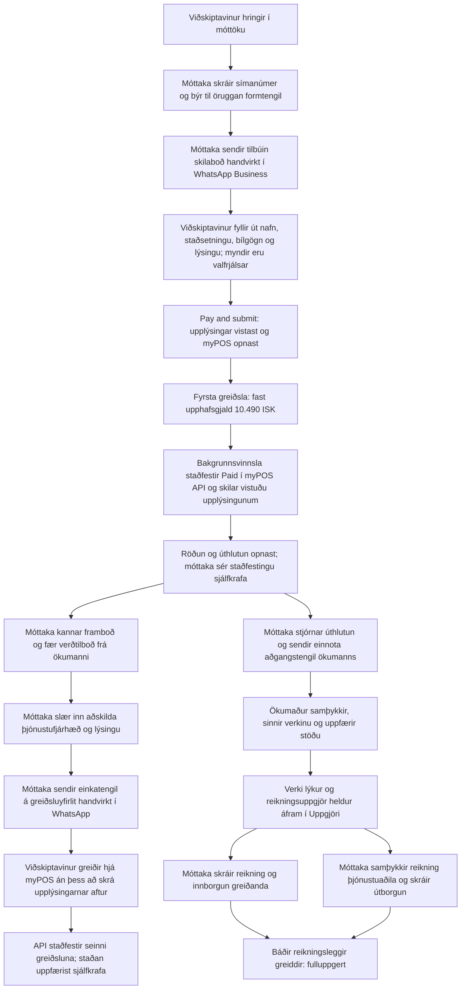

# Iceland Road Assistance — heildarferli kerfisins

Uppfært 21. október 2026. Flæðið hér sýnir núverandi handvirkar
WhatsApp-sendingar og tvær aðskildar myPOS-greiðslur.

## WhatsApp og upplýsingar

Allar sendingar eru handvirkar úr WhatsApp Business-reikningi fyrirtækisins.
Kerfið útbýr skilaboðin og örugga tengla; starfsmaður yfirfer viðtakanda og
ýtir á **Send**. Cloud API-sendingar eru í bið. Afhendingar- og lesstaða
handvirkra skilaboða er skoðuð í WhatsApp.

Viðskiptavinurinn skráir upplýsingar og myndir í kerfið. Myndir eru í einkageymslu
Supabase og verða aðgengilegar úthlutuðum ökumanni. Hann opnar einnota
aðgangstengil, staðfestir **Opna ökumannsskjá** og sér aðeins heimilaðar upplýsingar.
Hann þarf hvorki netfang né lykilorð. Móttaka ræður úthlutun og tímasetningu hennar;
seinni greiðsla er aðskilin frá aðgangi ökumanns og framvindu verks.

## Tvær greiðslur og uppgjör

Upphafsgjaldið er alltaf **10.490 ISK**. Seinni greiðslan er sjálfstæð fjárhæð
sem móttaka slær inn eftir verðtilboð ökumanns; upphafsgjaldið dregst ekki frá
henni. Viðskiptavinurinn skráir upplýsingar einu sinni og þarf ekki að snúa aftur
af myPOS-síðunni til að þær skili sér. Leiðréttingarform eftir staðfest
upphafsgjald notar **Send details securely** og innheimtir það ekki aftur.

Bakgrunnsvinnsla athugar myPOS um það bil á mínútu fresti. Greiðsluspjaldið hjá
móttöku sækir staðfesta gagnagrunnsstöðu á 15 sekúndna fresti meðan þess þarf.
Greiðslustaðfesting lýkur ekki verkinu og merkir ekki sjálfkrafa reikninga eða
þjónustuaðila sem uppgerða. Reikningshald og útgreiðsla til þjónustuaðila eru
aðskilin frá þessum tveimur myPOS-greiðslum.

Sjá [myPOS-uppsetningu](MYPOS_SETUP.md), [núverandi stöðu](implementation-status.md)
og [lokið símapróf](live-phone-audit-2026-10-21.md).

## Eldra kynningarflæðirit

[SVG](assets/vegstod-system-flowchart.svg) og
[PNG](assets/vegstod-system-flowchart.png) eru varðveittar eldri kynningarmyndir.
Þær sýna fyrra Cloud API-flæði og innihalda ekki nýja tveggja greiðslna ferlið.
Notið uppfærða flæðið hér að ofan fyrir núverandi kerfi.
